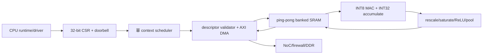

# 首代 edge NPU 架構設計

日期：2026-10-26，Asia/Taipei。狀態：design，待 G1 合約審查。
本文件是設計交付；本輪未修改 RTL，未跑模型或合成／STA／板級測試。

## 來源與現況

- orca-v63: `3d66ab0c9b16a4a35907d7729cafe3abebec379a`
- orca-ai-accelerators: `8059f10d6f1f54e3afbe676f71a71ba998172ade`
- openhelix-oh1: `8905c6d635372bab22be76524f4a58e28e9c850d`

唯一來源建議：orca-v63/accelerators/ 的固定 commit。
本 repo 既有 RTL 單行損壞，不可直接當 build 輸入；
不複製恢復版後在兩邊各自修改。
完整逐檔 blob manifest、治理 ADR 與 CPU/SKU/QoS 合約在總 repo：
docs/design/edge_npu_source_of_truth.md、
docs/design/edge_npu_source_manifest.json、
docs/design/edge_soc_integration.md（本輪設計 PR）。

|項目|design|RTL|verified|physical|
|---|---|---|---|---|
|Kestrel|有 GEMM/activation prototype|DMA stub、M/N 排程缺口|本輪未跑|未證實|
|Falcon/Hawk|既有陣列規格|靜態 operands 累加、DMA stub|本輪未跑|未證實|
|本文件 scheduler/DMA/量化|新增草案|未實作|未跑|未做|
|compiler/runtime/driver|既有文件加本輪收斂|tree 無交付實作證據|未跑模型|不適用|

Kestrel 讀 DMA 未把 m_axi_rdata 寫入 weight_mem/act_mem，
state 未等待交易完成；M/N 未形成完整矩陣 traversal。
mac_prod→mac_acc 有 nonblocking pipeline，缺少 valid/drain 的完整證據。
ops_cnt 每 COMPUTE 直接加 MAC_UNITS，非尾端有效 MAC 計數。
weight/activation 各 1024×8 = 1024 B，非註解的各 4KB；
result 256×8 = 256 B。cfg_int8_mode 不等於已有 INT16 datapath。
ReLU6 必須依 tensor scale/zero-point 定義，不能將 raw INT8 clamp 6
當所有模型的 ReLU6。共享 acc_quant 的組合賦值亦需修正/驗證。
這些是 source inspection 發現，未宣稱用模擬重現。

Falcon 只有一份 32×32 sa_acc，沒有可證實的第二組 dual array；
SYSTOLIC_DIM 寫死 32，MAC_ARRAY_DIM 參數未控制該陣列。
Falcon/Hawk compute 是對預載元素重複相乘累加，
沒有證明完整 K 維度的 systolic propagation/GEMM 正確性。
FMX decode 未以 valid 接受條件完整約束，記憶體仍標 stub；
ops counter 是 busy×名目 lane 數，不能作有效運算實測。

## 算力口徑與首代選型

dense peak ops/s = N_MAC × 每 MAC 每 cycle 的發射率 × f × 2。
只算成功完成的 signed INT8 multiply＋accumulate；scalar add 是 1 op。
頻率是估算假設，未經 STA；同一 MAC 不因 pipeline stage 數重複計數。

|來源配置|實體名目 MAC|假設頻率|理論 dense 上限|限制|
|---|---|---|---|---|
|Kestrel 預設|8|1GHz|16GOPS = 0.016TOPS|非 1TOPS，數學與 DMA 未驗證|
|Falcon 目前 source|32×32 = 1024|1.5GHz|3.072TOPS|非已證實 dual array|
|Hawk 目前 source|4×32×32 = 4096|2GHz|16.384TOPS|非可用 GEMM 效能|
|首代小原型 E8|8|250MHz|4GOPS|待實作與 STA|
|首代擴充候選 E64|64|250MHz|32GOPS|待模型/頻寬/面積決策|

以上發射率均假設 1；不能以更多 unsupported dtypes 或 sparse ratio 加倍。
首代只列 dense；稀疏若未硬體 skip、含 metadata 成本與相同精度測試，
不得報 sparse TOPS。E64 不因是「候選」就進入 SKU 承諾。

有效性能 = 模型有效 ops / 端到端秒數；
端到端涵蓋前處理、搬移、排隊、CPU fallback、NPU 與後處理。
另報 NPU active cycles、有效 MAC、tail/bank/DMA stall、f、
DDR bytes、accuracy；不得把忙碌週期或 padded zero MAC 算有效 ops。
roofline 上限 = min(dense peak, 實測可分配 DDR B/s × arithmetic intensity)。

算例（非模型測試）：32×32×32 GEMM = 32768 MAC = 65536 ops。
E8@250MHz 理想最少 4096 compute cycles = 16.384us；
若端到端假設 8192 cycles，則 2GOPS、50% 理想利用率。
輸入 A/B INT8、輸出 C INT32，無重用時共 6144B；
該假設端到端時間需 187.5MB/s payload。
1TOPS@1GHz、1MAC/cycle 至少需 500 MAC，8 lane 差 62.5 倍。
以上只算術，不是現有 RTL 實測。

## 方塊與資料流

首個可隔離版本採 E8、單 active job、雙 buffer，
先完成正確 GEMM 再加入其他 operators；不依賴 CPU custom FMX ISA。
descriptor 完整 snapshot 後才執行；同 job 內 commands 順序一致。
多 client 由 driver 軟體排隊，切換只在 job boundary，沒有硬體搶占。
跨 job 不保留未授權權重／activation，domain 切換清除 scratchpad。

## 運算與 tensor 格式

- GEMM：A[M,K]、B[K,N] row-major INT8；C INT32；tile M/N/K，
  tail lane mask，不足 lane 不計有效 MAC；各 output 累加初值明確為 bias/0。
- Conv2D：NHWC activation、OHWI weights，先採 tiled implicit-GEMM，
  stride/padding/dilation 在 compiler 驗證；初版 dilation=1，
  不支援的組合拒絕或明示 CPU fallback，禁止靜默近似。
- Depthwise：NHWC、[KH,KW,C,multiplier]，首版 multiplier=1；
  獨立 channel loop，不能以零填 dense 冒充高有效率。
- Activation：identity/ReLU；ReLU6 以量化後 q(6) 上限，
  GELU/Sigmoid/Softmax 首版 CPU fallback。
- Pool：max/average，明定 padding 是否計入 denominator；
  average 用規格化 rounding，首版固定 2×2 stride2，有其他形狀就 fallback。
- Rescale：acc32＋bias32 → 64-bit signed 乘 per-output-channel multiplier，
  shift 與 round-to-nearest ties-to-even → output zero-point → clamp INT8。
  signed INT8 weight 為 symmetric zero-point 0；activation 支援 signed INT8。
  非零 activation zero-point 用數學等價修正；首原型可只接受 zero-point 0，
  CAP 必須明示，compiler 不得送未支援格式。

所有 shape/stride/offset 都以 bytes 明示，little-endian，無隱含 NCHW。
C 中間結果維持 INT32；rescale 後才寫 INT8；溢位先以 64-bit golden 檢查。
127/−128、最壞 K、負 rounding、tail、padding 與 bias overflow 是必驗案例。
零維度與地址計算溢位拒絕提交。
模型像素前處理（色彩矩陣、crop、resize、mean/std）固定版本，
後處理 argmax/NMS 先 CPU，納入總 latency。

## SRAM banking 與搬移

E8 草案：weight 8 banks×1KiB、activation 8 banks×1KiB、
accumulator 8 banks×1KiB、output 8KiB，共 32KiB payload。
每 weight/activation bank 每 cycle 1-byte read，aggregate 各 8B/cycle；
acc bank 每 cycle 一筆 32-bit RMW，需 pipeline/bypass，
不能假設單埠 SRAM 同時獨立 read/write。
A/B 各一半容量 ping/pong；DMA 與 compute 使用不同 half，
bank conflict 要 stall，不能覆寫尚未消費資料。
SRAM macro、ECC、端口與面積須 physical owner 評估，不以 flop model 當實體 SRAM。

E64 必須重做 banking、reuse 與頻寬，不能只調 MAC_UNITS。
未重用的 64 lane×2 input bytes×250MHz = 32GB/s 本地讀需求；
E8 為 4GB/s。本地頻寬不是 DDR 需求，DDR 需求依 tile reuse/bytes 實測。
weight double buffering、activation reuse 與 spill 各自記帳。

DMA 草案：64-bit byte address、64-bit AXI4 data、INCR、
burst 最多16 beats、read/write 各最多2 outstanding、首版同方向單 ID。
4KB boundary 分割、非整 beat 以 byte strobes、末端長度明定；
讀寫 response 必須收完，錯誤上報，地址防 wraparound。
AXI4 AR/AW/LEN/SIZE/BURST/ID/LAST/RESP 等完整訊號由新 DMA 實作；
既有簡化 port 缺少 burst 語意，不可直接標為完整 AXI4。
DMA 不跨未驗證 security domain；range firewall 在 bus master 下游強制。

## CSR 與 job ABI v0 草案

全為 32-bit register，4-byte aligned；實際 SoC base 尚未分配。
VERSION/CAP 未支援位必須 0；未知 opcode/ABI major 回 EUNSUPPORTED。
本 ABI 不沿用既有 Kestrel cfg map，需 adapter 或新的 block VERSION。

|offset|register|語意|
|---|---|---|
|0x00|VERSION|RO，ABI major/minor|
|0x04|CAP|RO，MAC/format/operator/地址能力|
|0x08|CONTROL|W1S submit/abort；busy submit 回錯誤|
|0x0c|STATUS|RO busy/idle/draining；sticky error|
|0x10/14|DESC_LO/HI|RW shadow，submit 時原子 snapshot|
|0x18|IRQ_STATUS|W1C done/error；同拍新事件保留|
|0x1c|IRQ_ENABLE|RW mask|
|0x20|ERROR_CODE|RO 第一錯誤，明確 clear|
|0x24/28|COMPLETED_JOB_LO/HI|RO job ID snapshot|
|0x30/34|CYCLES_LO/HI|RO latched 64-bit counter|
|0x38/3c|VALID_MAC_LO/HI|RO 僅有效 retire MAC|
|0x40/44|DMA_RD_BYTES_LO/HI|RO accepted payload bytes|
|0x48/4c|DMA_WR_BYTES_LO/HI|RO completed payload bytes|

64-bit read 採 low read latch high，或專用 snapshot，避免 rollover 撕裂。
APB PREADY/PSLVERR、WSTRB adapter、AXI AW/W 獨立握手需實作測試。

job descriptor 固定 128B、64B aligned、little-endian（design）：

|bytes|欄位|規則|
|---|---|---|
|0..3|magic|ASCII ENP0|
|4..7|abi_major/minor|各 u16|
|8..15|job_id|u64，driver 分配|
|16..23|command_addr|u64 byte address|
|24..27|command_count|u32，1..1024|
|28..31|flags|u32，未知 bit 拒絕|
|32..39|completion_addr|u64，64B aligned|
|40..43|domain_id|u32，由 driver 覆核|
|44..47|timeout_cycles|u32，非0且受平台上限限制|
|48..55|range_table_addr|u64，16B aligned|
|56..59|range_count|u32，1..16|
|60..63|reserved|必須0|
|64..127|reserved|必須0|

range entry 16B：base u64、length u32、permission u32（R/W，未知位拒絕）。
只接受 driver 私有 immutable copy；不能驗證完後讓 userspace 改 descriptor。
command record 固定128B、64B aligned；以下為可審查的 ABI v0 草案，
G1 前不得發佈 stable userspace ABI。所有 reserved 必須0。

|bytes|欄位|規則|
|---|---|---|
|0..1|opcode u16|1 GEMM、2 RESCALE、3 MAXPOOL、4 AVGPOOL|
|2..3|flags u16|bit0 fuse bias、bit1 fuse ReLU；其餘0|
|4..7|layout/dtype/activation/reserved|各u8；layout=0 row-major或NHWC|
|8..11|dim0 u32|GEMM M；pool H；rescale 元素數|
|12..15|dim1 u32|GEMM N；pool W；rescale為0|
|16..19|dim2 u32|GEMM K；pool C；rescale為0|
|20..23|param0 u32|pool固定2×2 stride2；GEMM為0|
|24..31|src0 u64|A或輸入tensor|
|32..39|src1 u64|B；不用時0|
|40..47|dst u64|輸出tensor|
|48..55|bias u64|未fuse時0，INT32[N]|
|56..63|quant u64|未rescale時0|
|64..67|src0_row_stride u32|bytes|
|68..71|src1_row_stride u32|bytes|
|72..75|dst_row_stride u32|bytes|
|76..79|quant_count u32|1或output channels|
|80..83|input_zero_point i32|原型只接受0|
|84..87|output_zero_point i32|INT8範圍|
|88..91|clamp_min i32|輸出下界|
|92..95|clamp_max i32|輸出上界|
|96..127|reserved|必須0|

dtype=0 表 INT8×INT8→INT32 GEMM，dtype=1 表 INT32→INT8 rescale，
dtype=2 表 INT8 pool；其他組合拒絕。activation=0 identity、1 ReLU、
2 ReLU6（需quant資訊）；不支援的fuse flag回 EUNSUPPORTED。
quant entry 16B：signed multiplier i32、right_shift u32（0..31）、
reserved u64=0；累加用64-bit，ties-to-even後加output zero-point。
GEMM先輸出完整INT32，RESCALE獨立command；fuse只能在CAP宣告後使用。
pool的NHWC row stride至少 W×C bytes；輸出floor(H/2)×floor(W/2)×C，
奇數末行/列首版拒絕，避免padding分母歧義。
Conv/depthwise由compiler展開為tile GEMM＋必要CPU gather，
gather成本算進E2E；新增硬體直接conv opcode另提ABI minor草案。

completion 64B、64B aligned；bytes 0..7 job_id，
8..11 status（0成功/1失敗/2abort/3reset），12..15 error code，
16..23 cycles、24..31 valid_MAC、32..39 read bytes、
40..47 write bytes、48..51 fault command index、52..55 reserved=0，
56..63 valid_sequence（初值0，最後寫入非0 job sequence）。
payload stores收到response後，才寫valid_sequence；後者完成後才IRQ。
CPU先觀察fence/IRQ，再依DMA API invalidate/acquire與sequence讀record。
不允許completion region與command/input/output重疊；driver檢查。
range_table不能代替硬體firewall；descriptor/command先copy到可信區，
所有讀寫range逐一驗證（含matrix stride導出的最末byte）。
error code草案：1 EINVAL、2 EBOUNDS、3 EUNSUPPORTED、4 EBUS、
5 ETIMEOUT、6 EABORT、7 ERESET；0代表無錯誤。

## abort／安全／clock 與 power

單 job context 包含 tile index、DMA counters、domain、錯誤碼；
abort：不接新命令→停新 burst→drain 已握手交易→丟棄 partial output
→寫 error completion→IRQ→歸還 buffer。partial output 永不標成功。
response fault 記第一錯誤；timeout 不代表 AXI transaction 自動消失；
無法 drain 時交平台隔離/reset，只有 reset ACK 後才回收資源。
watchdog counter 獨立於 compute stall；非法 descriptor 不發 DMA。

CSR/NPU/DDR 可不同 clock，命令與完成用 async FIFO；
非同步 reset assert、各域同步 release，跨域 busy/IRQ 同步。
PMU 先 quiesce/drain 再 gating/retention；重啟 re-init CAP/queue，
掉電前 job 回 ERESET。debug 不可 bypass firewall；
secure tensors 首版禁止送此 nonsecure engine，scratchpad 換 domain 清除。

## 軟體現況與交付順序

遞迴 tree 的軟體證據只有 Software_Stack.md、compiler 計畫與 shell build；
未找到 importer/compiler/runtime/kernel-driver 的可建置實作。
文件中的 kestrel_delegate、FalconExecutionProvider、lib*.so、
-mfmx、orca-mlir-opt、sysfs paths 都是描述／範例，非已驗證功能。

|層|第一個可驗證交付|完成證據|
|---|---|---|
|importer|選一個 ONNX 或 TFLite，固定 opset/schema、shape/quant metadata|模型 SHA、解析測試|
|compiler|operator legality、fallback、NHWC/layout、tile/memory plan|逐 op golden、command dump|
|runtime|CAP/version check、buffer/fence、submit/wait、profiling|host mock + RTL co-sim|
|HAL|MMIO ordering、counter snapshot、IRQ/error/reset|bare-metal integration log|
|Linux driver|DMA API、range、IRQ、cancel、suspend、隔離|kernel build+target stress|
|SDK|模型/預處理版本、資源需求、fallback 明示|端到端報告|

先用離線 tensor/command generator，不等待完整 LLVM backend；
不依賴文件內自訂 GCC flags。Linux target 尚需 CPU/OS gate，
不能因 host golden 能跑就聲稱 target driver 可用。

## 模型端到端與驗證矩陣

候選 A：MobileNetV1-0.25、224×224、batch1 INT8 分類。
候選 B：SSD-MobileNetV1、300×300、batch1 INT8 偵測；
B 在 A 收斂後再做，NMS 先 CPU。
未下載權重、未挑定資料集；精確來源、license、SHA、校正集、
預處理與 accuracy 容許差異必須先固定，再有模型 go/no-go。
候選名稱不是可達成效能承諾，也不要求每個 camera frame 都推論。

|階段|獨立證據與案例|本輪狀態|
|---|---|---|
|CPU FP golden|固定模型/資料集、top1 或 mAP、逐 tensor dump|未跑|
|quant golden|獨立 INT64 reference、round/saturate/zero-point|未跑|
|operator RTL|signed/tail/padding/overflow、scoreboard 比每 tensor|未跑|
|CRV/SVA|地址界限、AW/W 分離、stall、4KB、error/reset/abort|未跑|
|formal/mutation|queue/abort/ownership FSM；記錄 kills/waiver|未跑|
|模型 RTL E2E|CPU→quant→compiled commands→RTL→CPU post|未跑|
|系統並行|camera/codec/display + AI、QoS/drop/latency|未跑|
|physical|SRAM macro、synth/STA、power、FPGA real DDR|未做|

E2E 報告必含：source/tool/model/input hashes、參數、時脈假設／實測、
accuracy 對 FP 的差、每 tensor 誤差、total/active/stall cycles、
有效 ops、DDR bytes、端到端 latency、CPU fallback 比例與失敗樣本。
量化容許門檻在測試前由產品 owner 固定，不能測完再挑好看的門檻。
scoreboard 不複用 DUT arithmetic；raw coverage、seed、waiver 一起保存。
本輪只交付 source inspection 與離線算術，沒有 RTL PASS 或 PPA 數字。
